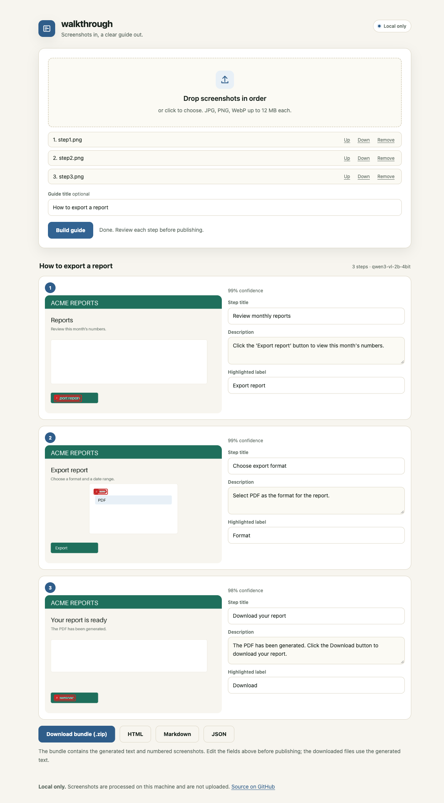

# walkthrough

[](https://github.com/iambiniyam/walkthrough/actions/workflows/ci.yml)
[](LICENSE)

Turn ordered screenshots into a step-by-step guide.

Drop a sequence of screenshots. walkthrough reads the interface labels, writes each step, draws a numbered callout around the control, and exports Markdown, HTML, JSON, and a ZIP bundle. Everything runs on your machine.



Status: v0.1.0. Local model, local review, no upload.

## Why

Support teams, teachers, and operations teams write the same guides over and over. The usual options are a cloud recorder that captures every click, or an afternoon in a document editor.

walkthrough takes the screenshots you already have and writes the first draft. You keep the review.

## What it does

- Accepts ordered screenshots by drag and drop, file picker, or paste.
- Reads UI labels with RapidOCR.
- Writes step titles and descriptions with Qwen3-VL-2B, 4-bit, on Apple MLX.
- Draws a numbered callout around the control named in each step.
- Lets you edit every title, description, and callout.
- Exports a Markdown guide, a standalone HTML page, JSON, and a ZIP with numbered images.
- Includes an npm/pnpm renderer for guide JSON: `walkthrough-render`.

## Quickstart

```bash
git clone https://github.com/iambiniyam/walkthrough.git
cd walkthrough
uv venv && source .venv/bin/activate
uv pip install -e ".[dev,model]"
python scripts/download_model.py
walkthrough build ./shots --out guide --title "How to export a report"
walkthrough serve
```

The model is about 1.7 GB and needs Apple Silicon. The first request loads it in a few seconds. Each screenshot takes about 4 to 12 seconds.

Without the model:

```bash
walkthrough build ./shots --out guide --model heuristic
```

The heuristic writer is for tests and demos. Do not publish its output.

## CLI

```bash
# a folder, sorted by filename
walkthrough build ./shots --out guide

# explicit order
walkthrough build shot-1.png shot-2.png shot-3.png --out guide

# check the runtime
walkthrough doctor
```

Output:

```
guide/
  guide.md
  guide.html
  guide.json
  guide.zip
  images/
    step-1.png
    step-2.png
```

## Web UI

`walkthrough serve` opens a local page with:

- ordered upload with move up, move down, and remove
- an optional guide title
- editable step titles, descriptions, and callout labels
- numbered callouts drawn on the screenshots
- download links for the bundle, HTML, Markdown, and JSON
- loading, error, and empty states
- automatic dark mode and mobile layouts
- keyboard access and visible focus

The page has no external fonts, scripts, or CDNs.

## Model

| Item | Value |
|---|---|
| Model | Qwen/Qwen3-VL-2B-Instruct, 4-bit MLX |
| License | Apache 2.0 |
| Size | about 1.7 GB |
| Runtime | mlx-vlm on Apple Silicon |
| OCR | RapidOCR, Apache 2.0 |
| Latency | about 4 to 12 seconds per screenshot on an 8 GB M-series Mac |

The model must not invent buttons that are not in the OCR labels. The prompt says so, and the heuristic fallback only uses labels it can see.

## npm package

`walkthrough-render` turns a guide JSON object into Markdown or standalone HTML in JavaScript. It is useful for docs sites and static generators that do not run Python.

```bash
pnpm add walkthrough-render
```

```js
import { renderMarkdown } from "walkthrough-render";
const markdown = renderMarkdown(guide);
```

The Python package and the npm package share the same guide JSON shape. The npm package does not run a model.

## Privacy

- No network calls at runtime.
- Screenshots are sent only to the local FastAPI process.
- Uploaded source screenshots are deleted after the guide is written.
- Generated guides stay in `~/.walkthrough/out` until you delete them.

## Limits

- Screenshots must be ordered before upload.
- OCR can miss small or low-contrast labels.
- The model can describe the wrong control. Review every step.
- The npm renderer does not annotate images. It uses the images already in the guide.
- The current model runtime is Apple Silicon only.

## Tests

```bash
pytest -q
```

The suite covers callout matching, the heuristic writer, guide building, annotation, Markdown and HTML rendering, and JSON round trips. It does not need the model.

## Roadmap

- automatic browser capture with a Playwright extension
- automatic step ordering
- redaction of sensitive text before sharing a guide
- PDF export
- translations and right-to-left layouts
- a hosted-free static guide viewer

## Related tools

- [alttext](https://github.com/iambiniyam/alttext): local alt-text and accessibility audit.
- [redact](https://github.com/iambiniyam/redact): offline PII redaction.
- [snap2sheet](https://github.com/iambiniyam/snap2sheet): receipts to spreadsheets.
- [formwise](https://github.com/iambiniyam/formwise): local PDF form filling.

## License

MIT. The Qwen model and RapidOCR have their own licenses. See [THIRD_PARTY.md](THIRD_PARTY.md).
